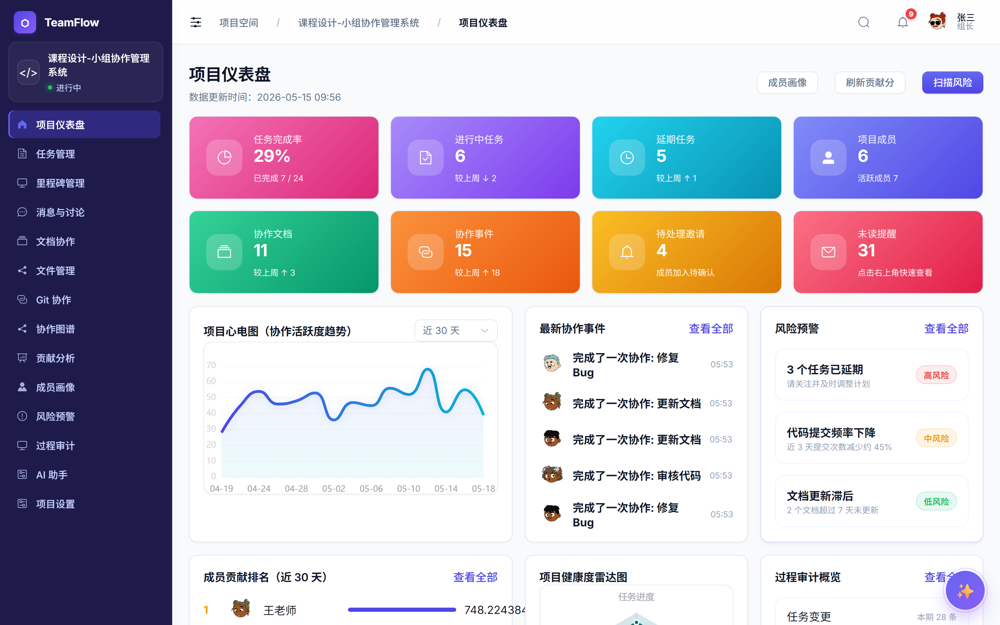
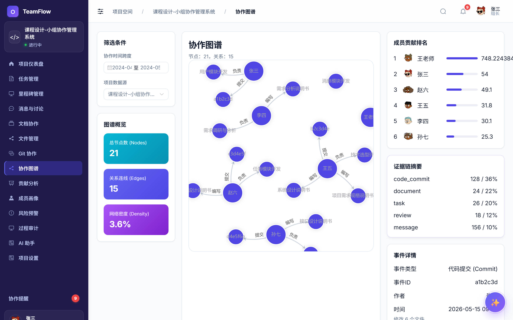

# TeamFlow

面向课程设计/软件工程课设的**团队协作平台**：以项目为中心、任务为主线、消息为触发、协作事件为审计依据，内置 AI 项目助手。FastAPI + Vue 3 双端架构。





## 功能速览

- **项目协作闭环**：项目 / 成员 / 邀请 / 任务看板 / 里程碑 / 任务讨论 / 文档协同 / 文件评审
- **实时消息**：项目群聊、任务讨论、AI 助手会话，WebSocket 推送
- **知识图谱**：AntV G6 可视化项目—任务—成员—文档关系
- **贡献与风险**：多维贡献评分、成员画像、风险预警扫描
- **TeamFlow AI**：项目规划、周报生成、文档分析、自然语言指令执行（受限动作白名单）
- **多模型支持**：用户可在设置中自选 OpenAI / DeepSeek / 通义千问 / GLM / Moonshot / MiMo 等任意 OpenAI 兼容模型

## 技术栈

| 后端 | 前端 |
| --- | --- |
| FastAPI · SQLAlchemy · SQLite · Pydantic · JWT · httpx | Vue 3 · TypeScript · Vite · Pinia · Vue Router · Element Plus · AntV G6 · ECharts |

## 快速开始

### 1. 后端（`backend/`）

```bash
pip install -r requirements.txt
uvicorn app.main:app --reload --port 8000
```

启动时自动建表并注入种子数据，默认账号 `zhangsan / 123456`。

可选：配置服务端默认 LLM（仅当用户未在 UI 中自行配置时生效）——在 `backend/.env` 写入：

```env
TEAMFLOW_LLM_API_KEY=your_key
TEAMFLOW_LLM_BASE_URL=https://api.openai.com/v1
TEAMFLOW_LLM_MODEL=gpt-4o-mini
```

### 2. 前端（`frontend/`）

```bash
npm install
npm run dev      # http://localhost:5173
```

打开页面，用 `zhangsan / 123456` 登录即可。进入任意项目 → **设置 → AI 模型配置** 选择模型提供商并填入自己的 API Key（可点「测试连接」验证）。

## 项目结构

```
backend/
  app/
    api/routes/      # FastAPI 路由（auth/projects/tasks/conversations/...）
    services/        # 业务逻辑（presenters / ai_service / llm_service / member_insights）
    models/          # SQLAlchemy 实体
    core/            # 配置、安全、WebSocket、种子数据
frontend/
  src/
    views/project/   # 项目内各页面（dashboard/tasks/messages/graph/...）
    components/common/  # GraphCanvas / LineChart / RadarChart / AIAssistantDock
    api/             # 统一 API 调用层
    stores/          # Pinia
docs/screenshots/    # README 截图
```

设计文档见 `开发文档.md`、`通信方案.md`、`现有功能清单.md`、`要求.md`。

## 截图采集

```bash
cd frontend
npm install              # 已含 playwright
node scripts/shot.mjs    # 自动登录并截取仪表盘 + 知识图谱
```

## 许可

本仓库为课程设计教学项目。
